# Практическая работа №3 — вариант 12

**Дисциплина:** Теория автоматов, языков и вычислений  
**Студент:** Шапельский М. В., КИ24-16/2Б  
**Тема:** Автоматы с магазинной памятью, контекстно-свободные грамматики и языки.

## 1. Цель и задания

Цель — построить магазинный автомат и контекстно-свободную грамматику, исследовать распознавание цепочек и доказать неконтекстно-свободность языка.

1. **L12 = { aⁿbᵐ | n,m ≥ 0, n ≠ m }** — построить магазинный автомат.
2. **L28 = { aⁿbᵐcᵏ | n,m,k ≥ 0, k = n + m }** — построить контекстно-свободную грамматику.
3. **L44 = { w ∈ {a,b,c}* | nₐ(w) = nᵦ(w) = n꜀(w) }** — доказать, что язык не является контекстно-свободным.

## 2. Магазинный автомат для L12

Файл: [L12_PDA.jff](L12_PDA.jff).

M = (Q, Σ, Γ, δ, q0, Z, F), где:

- Q = {q0, q1, q2, q3, q4};
- Σ = {a, b};
- Γ = {A, Z};
- q0 — начальное состояние;
- Z — начальный символ магазина;
- F = {q3, q4} — финальные состояния.

**Критерий принятия:** по финальному состоянию после полного прочтения цепочки.

Автомат помещает в магазин по одному символу A за каждую букву a, а затем извлекает по одному A за каждую букву b. Если после чтения цепочки остаётся A, то n > m, и цепочка принимается в q3. Если A закончились и встретилась дополнительная b, то n < m, и цепочка принимается в q4. При n = m цепочка отвергается.

| Переход | Читаем | Снимаем | Кладём |
|---|---|---|---|
| q0 → q0 | a | Z | AZ |
| q0 → q0 | a | A | AA |
| q0 → q1 | ε | Z | Z |
| q0 → q1 | ε | A | A |
| q1 → q1 | b | A | ε |
| q1 → q3 | ε | A | A |
| q1 → q2 | b | Z | Z |
| q2 → q2 | b | Z | Z |
| q2 → q4 | ε | Z | Z |

### Проверка цепочек

В конфигурации (состояние, непрочитанная часть входа, магазин) верх магазина находится слева.

**Цепочка aab — принимается (2 > 1):**

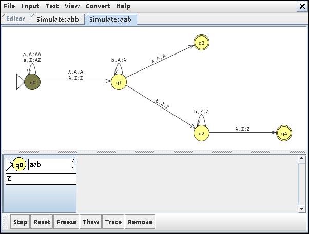

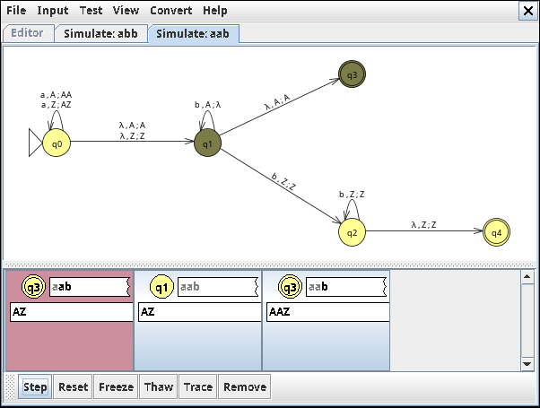

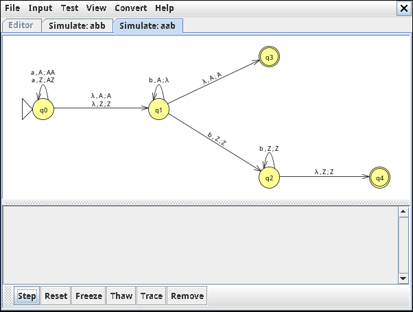

```text
(q0, aab, Z)
→ (q0, ab, AZ)
→ (q0, b, AAZ)
→ (q1, b, AAZ)
→ (q1, ε, AZ)
→ (q3, ε, AZ) — ACCEPT
```

**Цепочка abb — принимается (1 < 2):**

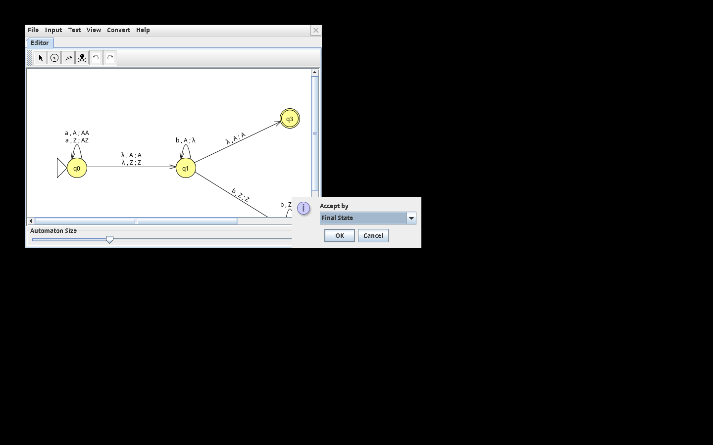

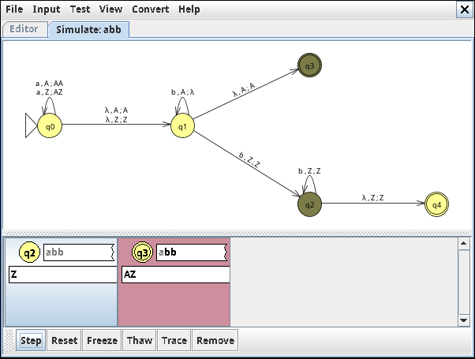

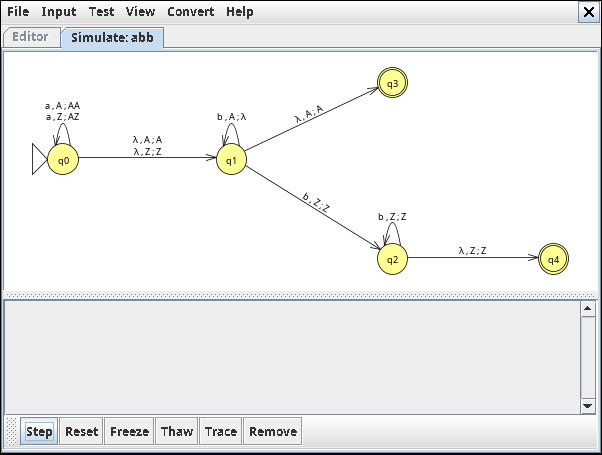

```text
(q0, abb, Z)
→ (q0, bb, AZ)
→ (q1, bb, AZ)
→ (q1, b, Z)
→ (q2, ε, Z)
→ (q4, ε, Z) — ACCEPT
```

**Цепочка aabb — отвергается (2 = 2):**

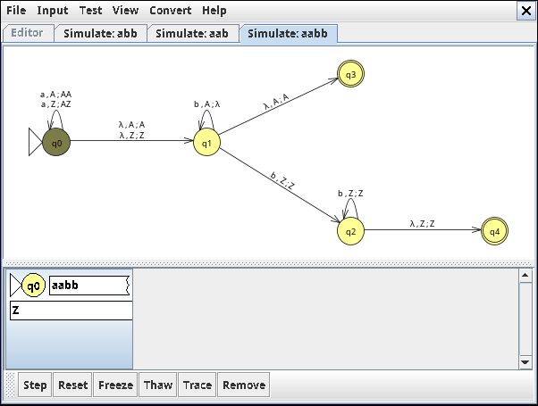

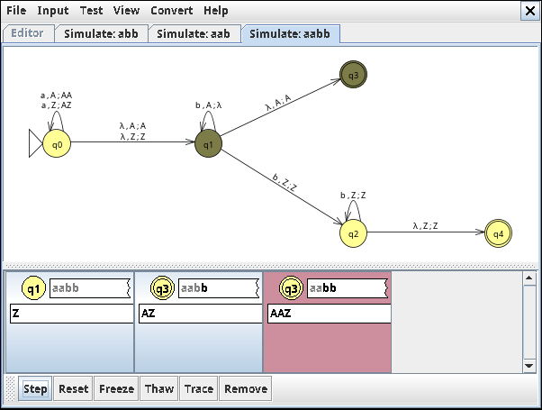

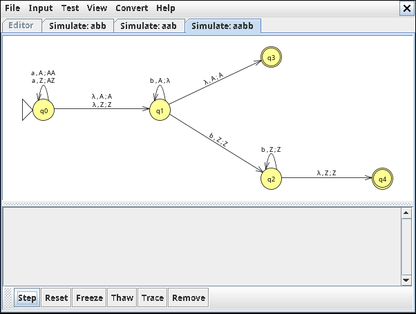

```text
(q0, aabb, Z)
→ (q0, abb, AZ)
→ (q0, bb, AAZ)
→ (q1, bb, AAZ)
→ (q1, b, AZ)
→ (q1, ε, Z) — REJECT
```

Также: a — ACCEPT; b — ACCEPT; ab — REJECT; ε — REJECT; ba — REJECT.

## 3. Контекстно-свободная грамматика для L28

Файл: [L28_CFG.jff](L28_CFG.jff).

Грамматика G = (V, Σ, P, S):

- V = {S, T};
- Σ = {a, b, c};
- P: S → aSc | T; T → bTc | ε;
- S — начальный символ.

Правило S → aSc добавляет по одному символу a и c, правило T → bTc — по одному b и c. Поэтому число c равно сумме числа a и b.

**Вывод aabbcccc:**

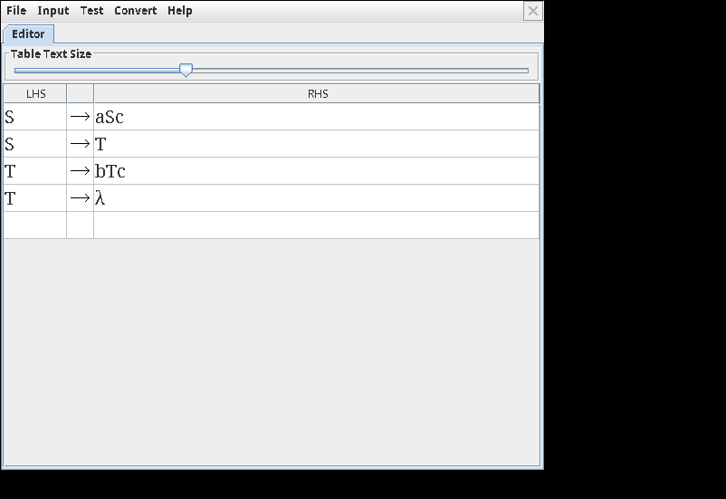

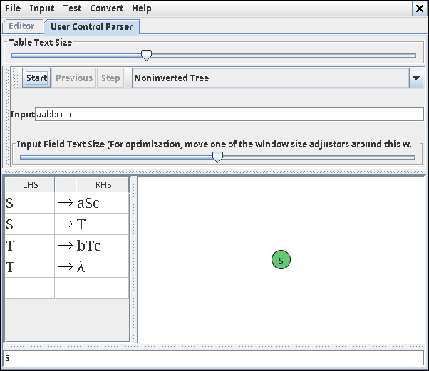

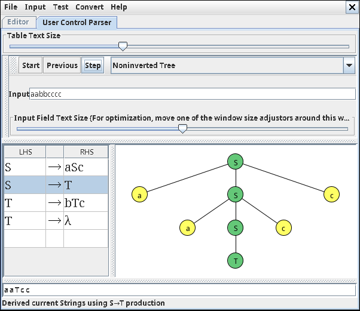

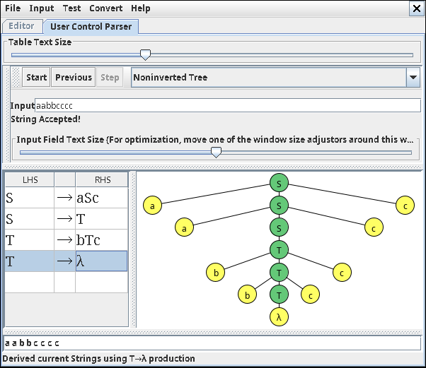

```text
S ⇒ aSc ⇒ aaScc ⇒ aaTcc ⇒ aabTccc ⇒ aabbTcccc ⇒ aabbcccc
```

| Цепочка | Результат |
|---|---|
| ε | ACCEPT |
| ac | ACCEPT |
| bc | ACCEPT |
| abcc | ACCEPT |
| aabbcccc | ACCEPT |
| abc | REJECT |
| aabbc | REJECT |
| aabbbcc | REJECT |

**Проверка грамматики в JFLAP:**

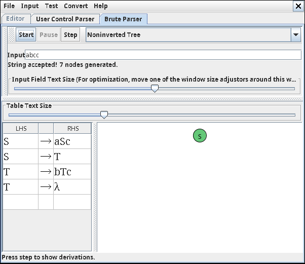

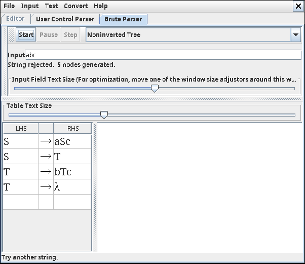

## 4. Доказательство, что L44 не является контекстно-свободным

Предположим противное: язык L44 контекстно-свободен. По лемме о разрастании существует p ≥ 1, такое что всякое достаточно длинное слово s ∈ L44 можно представить в виде s = uvxyz, где |vxy| ≤ p, |vy| > 0 и uvⁱxyⁱz ∈ L44 для всех i ≥ 0.

Возьмём s = aᵖbᵖcᵖ. Это слово принадлежит L44. Поскольку |vxy| ≤ p, подслово vxy не может одновременно содержать символы из блоков a и c: между ними расположен блок из p символов b. Значит, v и y затрагивают не более двух типов символов.

При i = 2 количество хотя бы одного типа символов увеличится, поскольку |vy| > 0, а количество хотя бы одного другого типа останется неизменным. Следовательно, в uv²xy²z числа a, b и c уже не будут равны. Получили противоречие лемме.

**Вывод:** L44 не является контекстно-свободным языком.

## 5. Результаты работы

Для языка L12 построен магазинный автомат с принятием по финальному состоянию. Проверены примеры с n > m, n < m и n = m. Для языка L28 построена контекстно-свободная грамматика, порождающая строки вида aⁿbᵐcⁿ⁺ᵐ. Для языка L44 с помощью леммы о разрастании доказана неконтекстно-свободность.

## 6. Файлы работы

- [L12_PDA.jff](L12_PDA.jff) — магазинный автомат.
- [L28_CFG.jff](L28_CFG.jff) — контекстно-свободная грамматика.
- [screenshots/](screenshots/) — скриншоты пошагового распознавания и проверки грамматики в JFLAP 7.1.
- README.md — описание, примеры распознавания и доказательство.


### Полная последовательность снимков JFLAP

Ниже приведены все шаги моделирования и вывода в порядке выполнения. Некоторые изображения также показаны выше рядом с соответствующими объяснениями.

<details>
<summary>Все шаги: aab</summary>


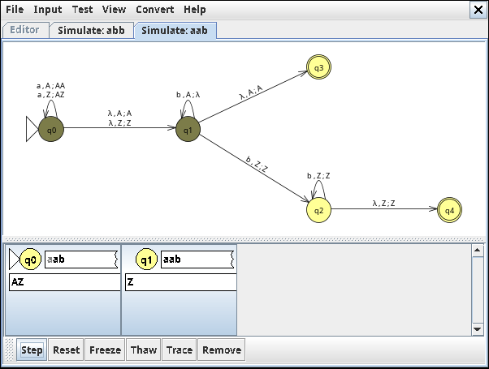

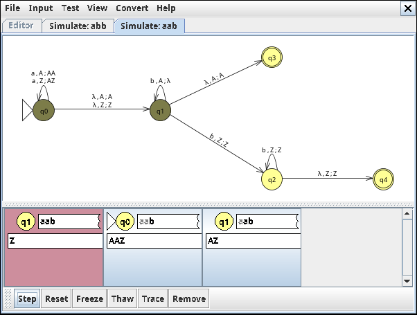

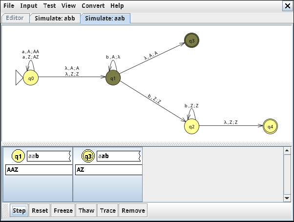


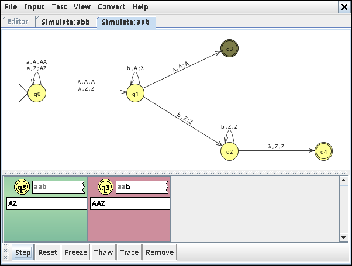


</details>

<details>
<summary>Все шаги: abb</summary>


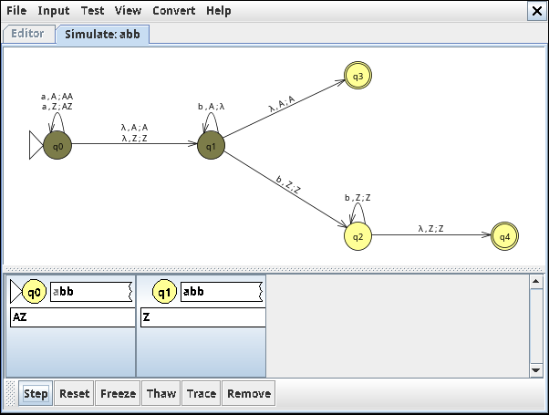

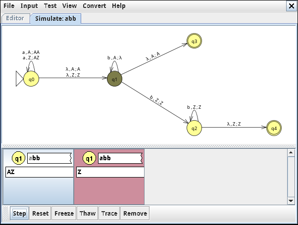

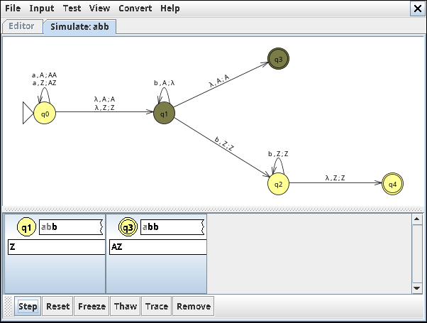


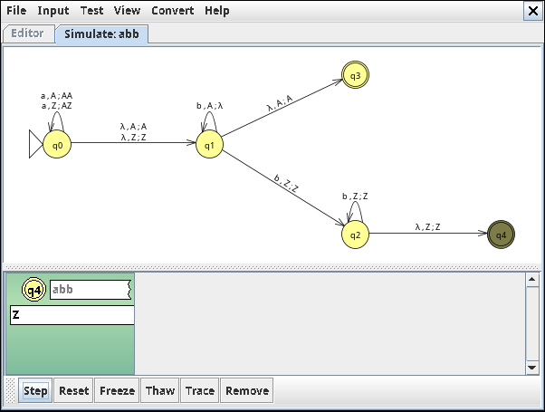


</details>

<details>
<summary>Все шаги: aabb</summary>


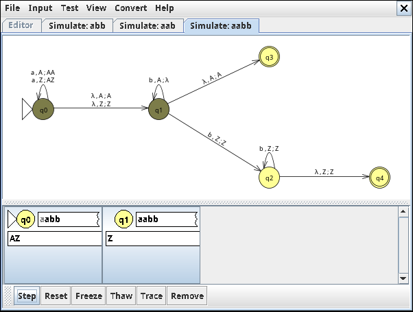

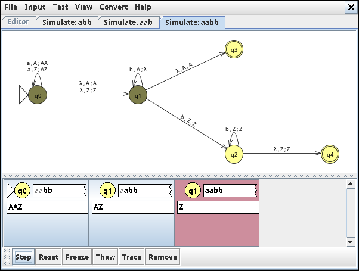

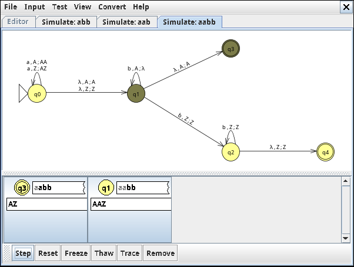

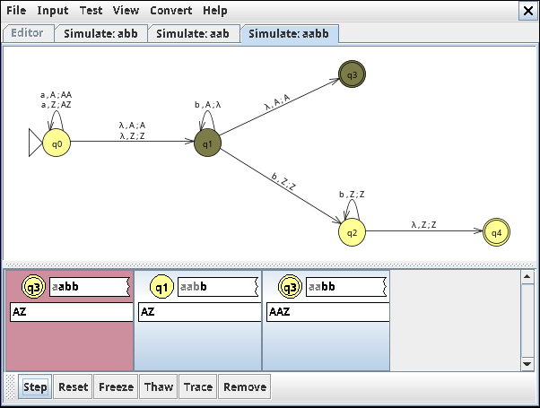


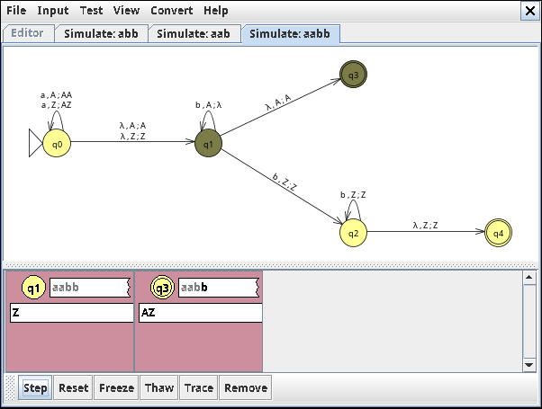


</details>

<details>
<summary>Все шаги: вывода грамматики</summary>


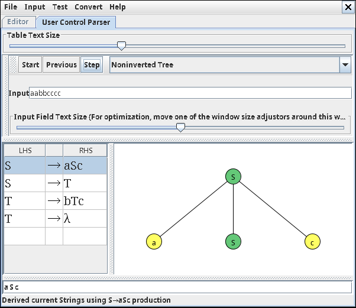

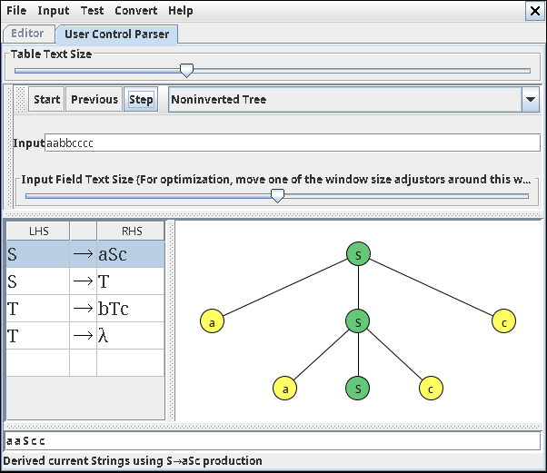


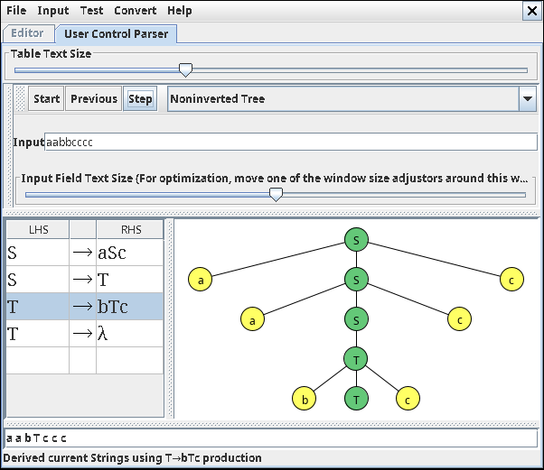

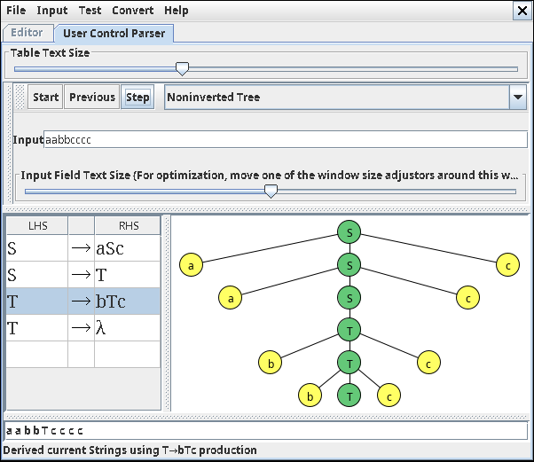


</details>
