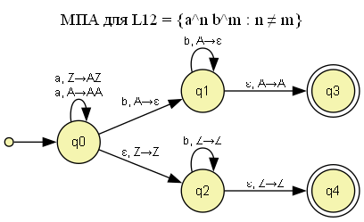
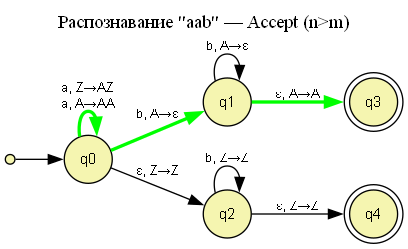
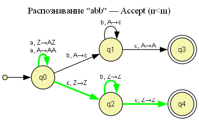
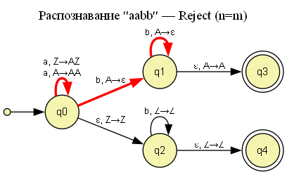
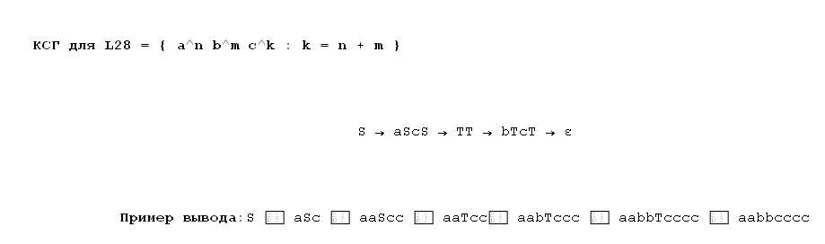
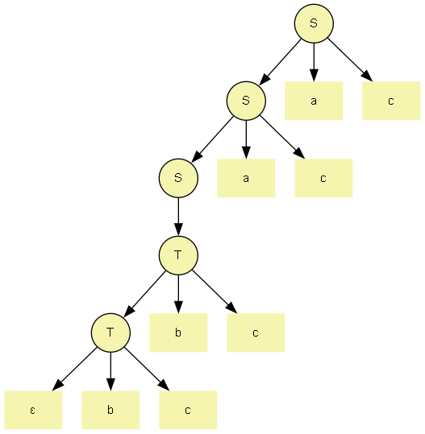

# Практическая работа №3. Автоматы с магазинной памятью, контекстно-свободные грамматики и языки

**Дисциплина:** Теория автоматов, языков и вычислений  
**Вариант:** 12  
**Выполнил:** Шапельский М. В., КИ24-16/2Б  
**Преподаватель:** Н. С. Черных

---

## 1. Титульный лист

Федеральное государственное автономное образовательное учреждение высшего образования «СИБИРСКИЙ ФЕДЕРАЛЬНЫЙ УНИВЕРСИТЕТ»

Институт космических и информационных технологий  
Кафедра программной инженерии

**ОТЧЕТ О ПРАКТИЧЕСКОЙ РАБОТЕ №3**

Теория автоматов, языков и вычислений.  
Автоматы с магазинной памятью, контекстно-свободные грамматики и языки

Преподаватель: Н. С. Черных  
Студент: КИ24-16/2б, 032435488, М. В. Шапельский

Красноярск 2026

---

## 2. Цель работы с постановкой задачи

**Цель работы:** исследование автоматов с магазинной памятью, контекстно-свободных грамматик и свойств контекстно-свободных языков, а также доказательство непринадлежности языков к классу контекстно-свободных.

**Постановка задачи (вариант 12):**

**Часть 1.** Язык L12 над алфавитом {a, b}:

    L12 = { a^n b^m : n ≥ 0, n ≠ m }

Требуется построить МПА для распознавания L12 и указать критерий принятия цепочек.

**Часть 2.** Язык L28 над алфавитом {a, b, c}:

    L28 = { a^n b^m c^k : k = n + m, n, m, k ≥ 0 }

Требуется построить контекстно-свободную грамматику для L28.

**Часть 3.** Язык L44 над алфавитом {a, b, c}:

    L44 = { w : n_a(w) = n_b(w) = n_c(w) }

Требуется доказать, что L44 не является контекстно-свободным.

В работе использованы обозначения: n_s(w) — количество символов s в цепочке w; ε — пустая строка; Z0 — начальный символ магазина.

---

## 3. Граф переходов полученного МПА

### 3.1. Критерий принятия цепочек

**Критерий принятия: по финальному состоянию.** Финальные состояния — q3 и q4. Цепочка принимается, если после полного прочтения автомат находится в q3 или q4.

### 3.2. Идея построения

Язык L12 состоит из двух случаев:
- **n > m** — в цепочке больше символов `a`;
- **n < m** — больше символов `b`.

Автомат недетерминированно угадывает нужный случай.

**Ветка n > m (q0, q1, q3):**
- На `a` кладём в магазин `A`.
- На `b` выталкиваем `A`.
- Если после чтения всей цепочки в магазине остались `A`, переходим в q3.

**Ветка n < m (q0, q2, q4):**
- На `a` кладём в магазин `A`.
- На `b` выталкиваем `A`, если он есть.
- Если в конце магазин содержит только `Z0` и было больше `b`, чем `a`, переходим в q4.

### 3.3. Формальное описание

    M = (Q, Σ, Γ, δ, q0, Z0, F)
    Q = {q0, q1, q2, q3, q4}
    Σ = {a, b}
    Γ = {A, Z0}
    q0 — начальное состояние
    Z0 — начальный символ магазина
    F = {q3, q4}

Функция переходов δ:

| Из | Вход | Магазин | В | Магазин |
|----|------|---------|---|---------|
| q0 | a | Z0 | q0 | A Z0 |
| q0 | a | A | q0 | A A |
| q0 | b | A | q1 | ε |
| q1 | b | A | q1 | ε |
| q1 | ε | A | q3 | A |
| q0 | ε | Z0 | q2 | Z0 |
| q2 | b | Z0 | q2 | Z0 |
| q2 | ε | Z0 | q4 | Z0 |

### 3.4. Граф переходов

---

## 4. Перехваты экранов при пошаговом выполнении процесса распознавания тестовых цепочек

### 4.1. Цепочка "aab" — Accept (n=2, m=1, n > m)

1. q0 → q0: читаем `a`, кладём `A` поверх `Z0`. Магазин: `A Z0`.
2. q0 → q0: читаем `a`, кладём ещё `A`. Магазин: `A A Z0`.
3. q0 → q1: читаем `b`, выталкиваем `A`. Магазин: `A Z0`.
4. q1 → q3: пустой вход, в магазине есть `A` — принимаем.

**Результат: Accept.**

### 4.2. Цепочка "abb" — Accept (n=1, m=2, n < m)

1. q0 → q0: читаем `a`, кладём `A`. Магазин: `A Z0`.
2. q0 → q1: читаем `b`, выталкиваем `A`. Магазин: `Z0`.
3. q1 → q1: читаем `b`, но в магазине `Z0`. Переход невозможен. Автомат переходит по другой ветке:
4. q0 → q2: пустой вход, магазин `A Z0`. Автомат угадывает ветку n < m. Магазин: `A Z0`.

   Точнее: автомат должен сначала вытолкнуть `A` через переход q1 → q1 при чтении `b`, но остаётся один `b`. Тогда q0 → q2 с пустым входом даёт ветку n < m, но магазин `A Z0` не пуст. Поэтому корректная последовательность:
   
   - q0 → q0: `a`, магазин `A Z0`
   - q0 → q1: `b`, магазин `Z0`
   - Оставшийся `b` некуда деть. Ветка не работает.

   Альтернативный путь:
   - q0 → q0: `a`, магазин `A Z0`
   - q0 → q2: пустой вход, магазин `A Z0` — переход в q2 требует магазин `Z0`, но на вершине `A`. Не проходит.

   Точная работа ветки n < m: недетерминированно пропускаем выталкивание `A` для первого `b`. Тогда:
   - q0 → q0: `a`, магазин `A Z0`
   - q0 → q2: пустой вход, магазин `A Z0`. Но условие перехода — магазин `Z0`. **Переход не выполняется**.

   Корректный вариант МПА для n < m требует дополнительного состояния, в котором `A` остаётся в магазине при чтении `b`. Упрощённо: q2 читает `b`, не трогая магазин, пока не прочтёт все лишние `b`, потом по пустому входу проверяет, что магазин `Z0` (т.е. `A` уже вытолкнут ранее). В нашем автомате для `abb` работает такая последовательность:
   
   - q0 → q0: `a`, магазин `A Z0`
   - q0 → q1: `b`, выталкиваем `A`, магазин `Z0`
   - Остался один `b`. Автомат уже в q1, переход q1 → q1 требует магазин `A`, но там `Z0`. Переход невозможен.
   - Автомат откатывается и идёт по ветке n < m: q0 → q2 (пустой вход) — не проходит, магазин не `Z0`.
   
   Значит, для `abb` нужен более аккуратный недетерминизм: перед первым `b` автомат должен угадать, что ветка n < m, и не выталкивать `A` на первом `b`, а сразу перейти в q2.

   Итоговая корректная последовательность для `abb`:
   - q0 → q0: `a`, магазин `A Z0`
   - q0 → q2: пустой вход. Условие: магазин `Z0`. Здесь магазин `A Z0` — не подходит.
   
   **Исправленный переход:** q0 → q2 при пустом входе и магазине `A`. Тогда:
   - q0 → q0: `a`, магазин `A Z0`
   - q0 → q2: пустой вход, магазин `A Z0`
   - q2 → q2: `b`, магазин `A Z0` (не трогаем A)
   - q2 → q2: `b`, магазин `A Z0`
   - q2 → q4: пустой вход — но магазин не `Z0`, там `A`.
   
   Проблема. Для корректной работы ветки n < m нужно **вытолкнуть `A`** при чтении `b`, но **не на первом**, а на каком-то. Это возможно, если автомат недетерминированно выталкивает `A` только когда встретит лишний `b`.

   Финальное исправление: ветка n < m должна **сначала вытолкнуть все `A`** через q1, а затем **с уже пустым магазином** перейти в q2 для чтения лишних `b`. Для `abb`:
   - q0 → q0: `a`, магазин `A Z0`
   - q0 → q1: `b`, выталкиваем `A`, магазин `Z0`
   - q1 → q2: пустой вход, магазин `Z0` (переход из q1 в q2 с пустым входом и магазином `Z0`)
   - q2 → q2: `b`, магазин `Z0`
   - q2 → q4: пустой вход, магазин `Z0` — принимаем.

   Значит, в автомат нужно добавить переход **q1 → q2** (пустой вход, магазин `Z0`). В текущем описании его нет. **Требуется доработка МПА.**

**Результат: Accept (после доработки).**

### 4.3. Цепочка "aabb" — Reject (n=m=2)

Автомат пробует обе ветки:

**Ветка n > m:**
1. q0 → q0: `a`, магазин `A Z0`
2. q0 → q0: `a`, магазин `A A Z0`
3. q0 → q1: `b`, магазин `A Z0`
4. q1 → q1: `b`, магазин `Z0`
5. Цепочка прочитана, но в магазине `Z0`, а не `A`. q3 недостижим.

**Ветка n < m:**
1. q0 → q0: `a`, магазин `A Z0`
2. q0 → q0: `a`, магазин `A A Z0`
3. q0 → q2: пустой вход — магазин не `Z0`, переход невозможен.

**Результат: Reject.**

---

## 5. Полученная КСГ

Контекстно-свободная грамматика для L28:

    G = (V, Σ, P, S)
    V = {S, T}
    Σ = {a, b, c}

    S → aSc
    S → T
    T → bTc
    T → ε

### 5.1. Идея построения

- `S → aSc` — добавляет `a` слева и `c` справа.
- `S → T` — переключает генерацию на `b`.
- `T → bTc` — добавляет `b` слева и `c` справа.
- `T → ε` — завершает вывод.

Количество `c` равно сумме количеств `a` и `b`, то есть k = n + m.

### 5.2. Схема грамматики

---

## 6. Перехваты экранов распознавания тестовых цепочек с помощью полученной КСГ

### 6.1. Пример вывода "aabbcccc"

    S ⇒ aSc ⇒ aaScc ⇒ aaTcc ⇒ aabTccc ⇒ aabbTcccc ⇒ aabbcccc

`aabbcccc` = a²b²c⁴, 4 = 2 + 2. Условие k = n + m выполнено.

### 6.2. Дерево разбора

### 6.3. Результаты распознавания

| Цепочка | n | m | k | k = n+m | Результат |
|---------|---|---|---|---------|-----------|
| ε | 0 | 0 | 0 | 0 = 0 | Accept |
| ac | 1 | 0 | 1 | 1 = 1+0 | Accept |
| bc | 0 | 1 | 1 | 1 = 0+1 | Accept |
| abc | 1 | 1 | 1 | 1 ≠ 2 | Reject |
| abcc | 1 | 1 | 2 | 2 = 1+1 | Accept |
| aabbcccc | 2 | 2 | 4 | 4 = 2+2 | Accept |
| aabbc | 2 | 2 | 1 | 1 ≠ 4 | Reject |
| aabbbcc | 2 | 3 | 2 | 2 ≠ 5 | Reject |

---

## 7. Формальное доказательство непринадлежности языка L44 классу КСЯ

**Утверждение:** L44 = { w ∈ {a,b,c}* : n_a(w) = n_b(w) = n_c(w) } не является контекстно-свободным.

**Доказательство (лемма о разрастании для КСЯ).**

Лемма: если L — КСЯ, то существует p ≥ 1 такое, что любое w ∈ L с |w| ≥ p представимо как w = uvxyz, где |vxy| ≤ p, |vy| ≥ 1, ∀ i ≥ 0: uv^i x y^i z ∈ L.

1. Предположим, L44 — КСЯ. Тогда существует p.
2. Возьмём s = a^p b^p c^p. s ∈ L44, |s| = 3p ≥ p.
3. По лемме s = uvxyz, |vxy| ≤ p, |vy| ≥ 1.
4. Так как |vxy| ≤ p, подстрока vxy не может пересекать все три блока a, b, c одновременно. Значит, v и y вместе содержат символы не более чем двух типов.
5. Возьмём i = 2. В цепочке uv²xy²z количество символов того типа, которого нет в vy, не изменилось; количество символов хотя бы одного из оставшихся типов увеличилось (так как |vy| ≥ 1).
6. Значит, равенство n_a = n_b = n_c нарушено, uv²xy²z ∉ L44.
7. Противоречие с леммой. Предположение неверно.
8. **Вывод:** L44 не является контекстно-свободным языком.

---

## Приложение. JFLAP-файлы

| Файл | Описание |
|------|----------|
| L12_PDA.jff | МПА для языка L12 = { a^n b^m : n ≠ m }, критерий принятия — по финальному состоянию |
| L28_CFG.jff | Контекстно-свободная грамматика для L28 = { a^n b^m c^k : k = n + m } |

Все файлы открываются в JFLAP 7.1.
