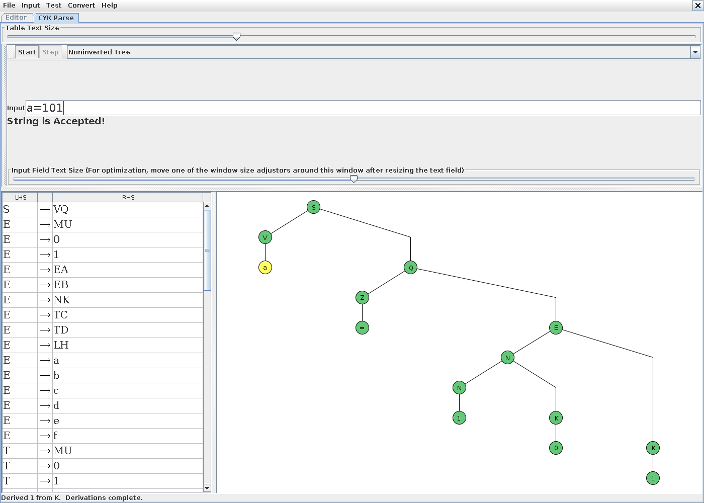
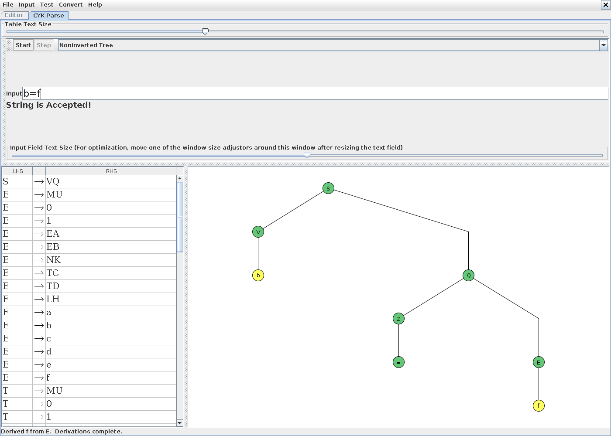
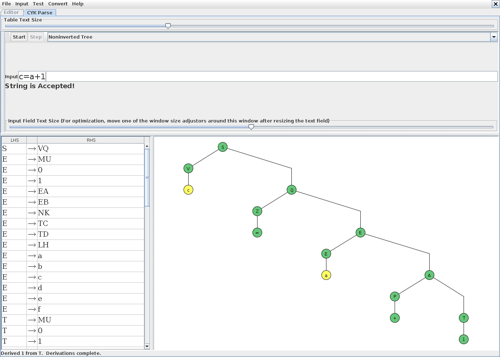
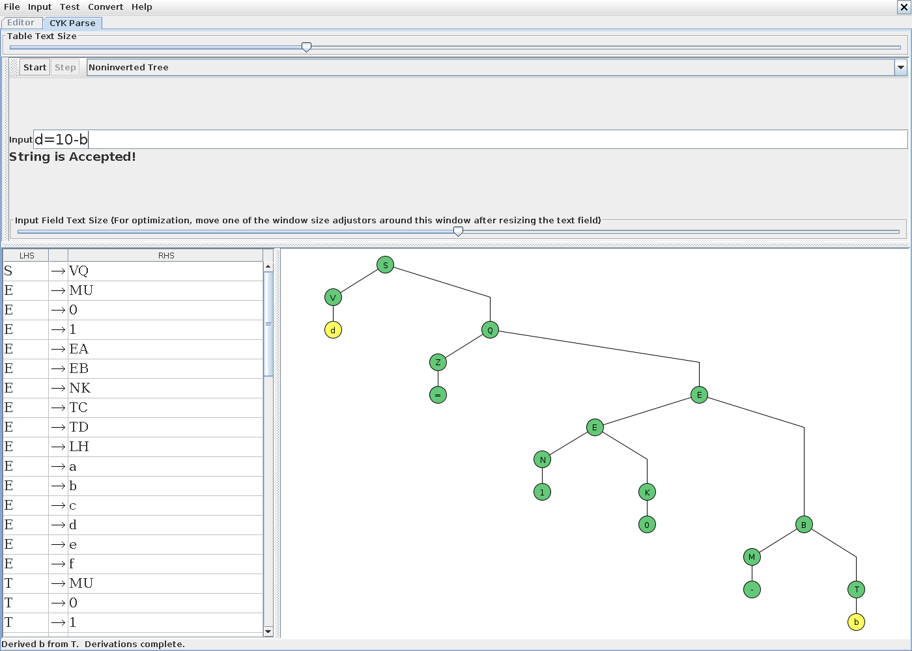
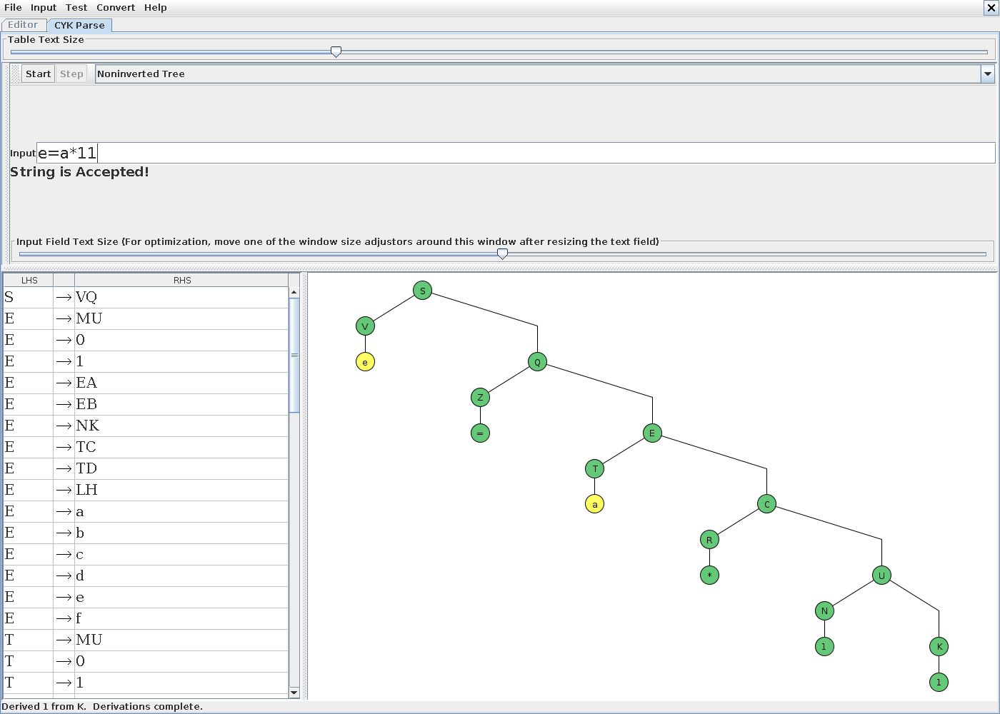
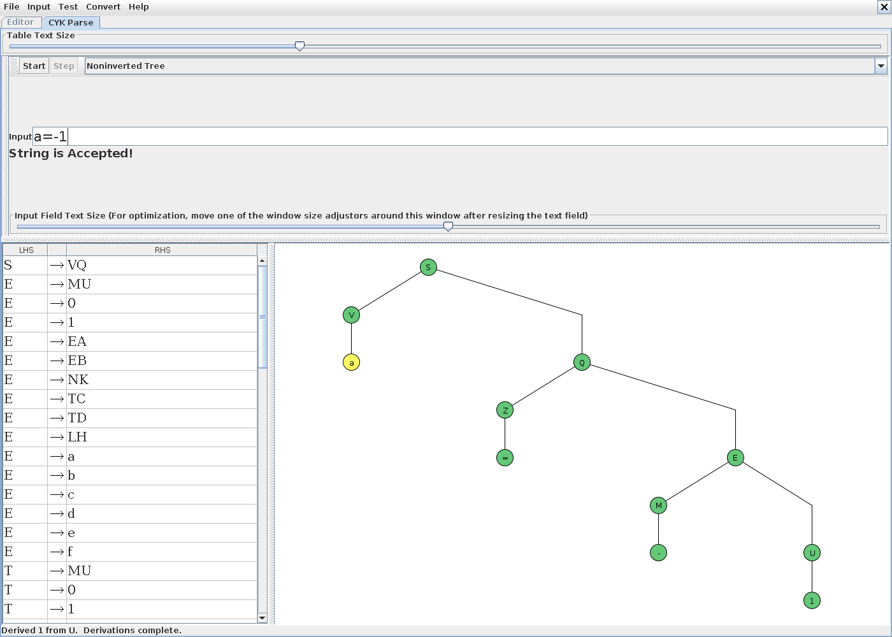
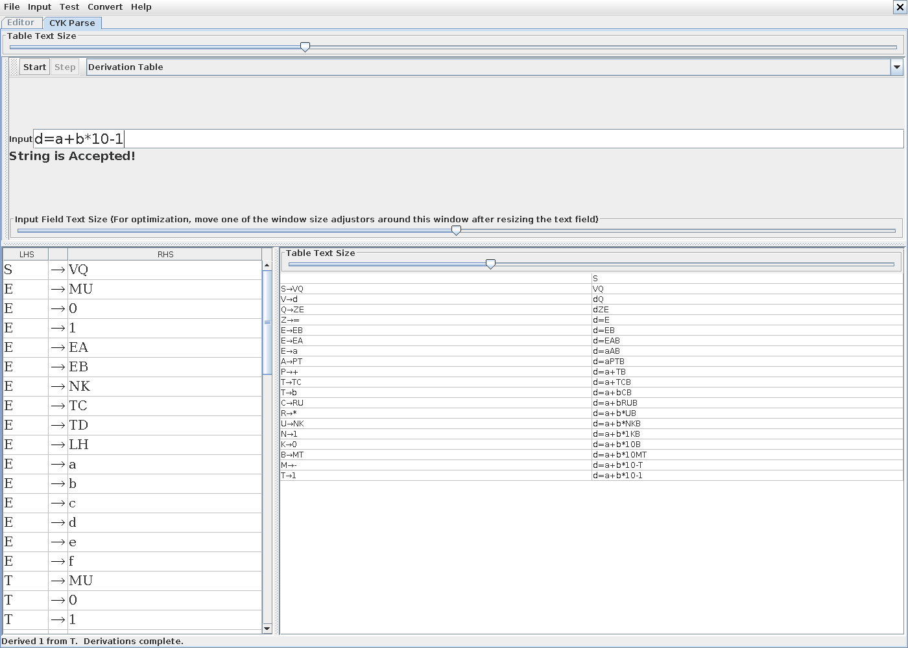
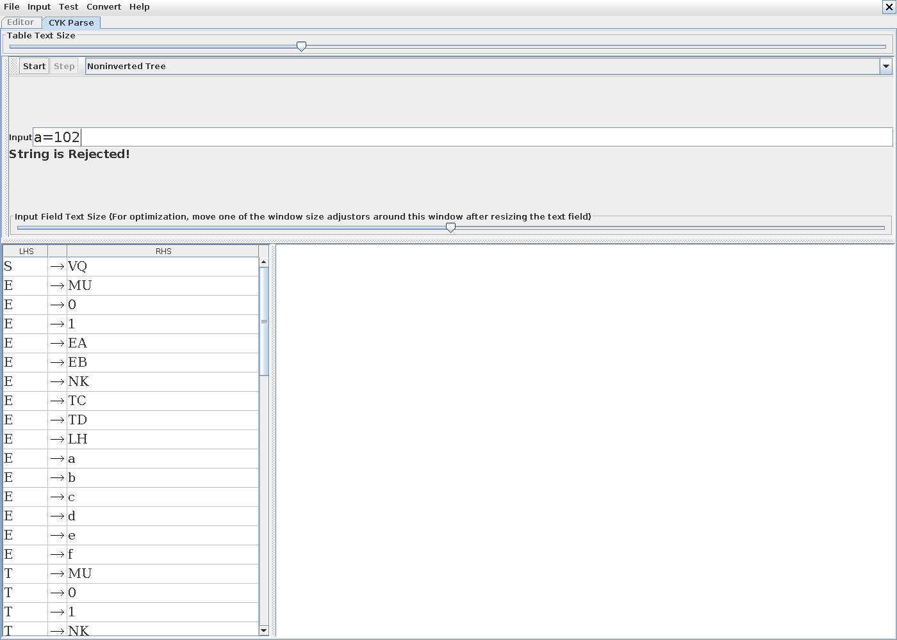
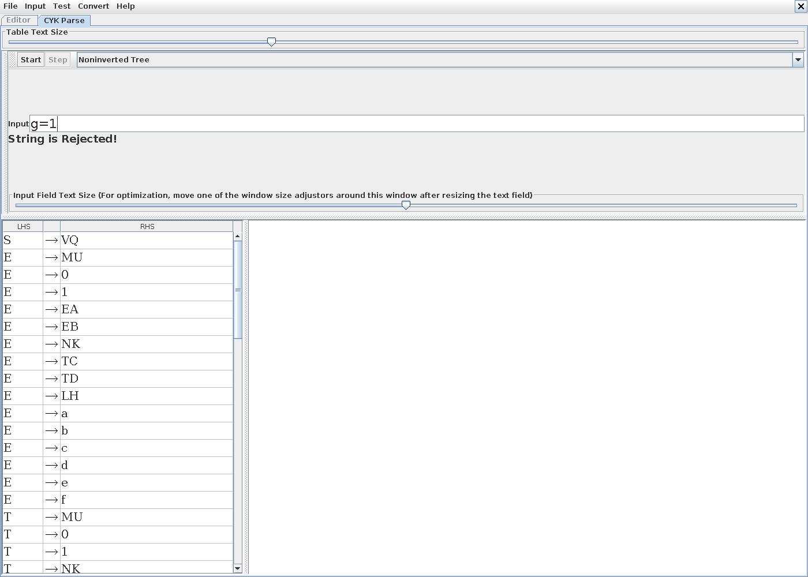
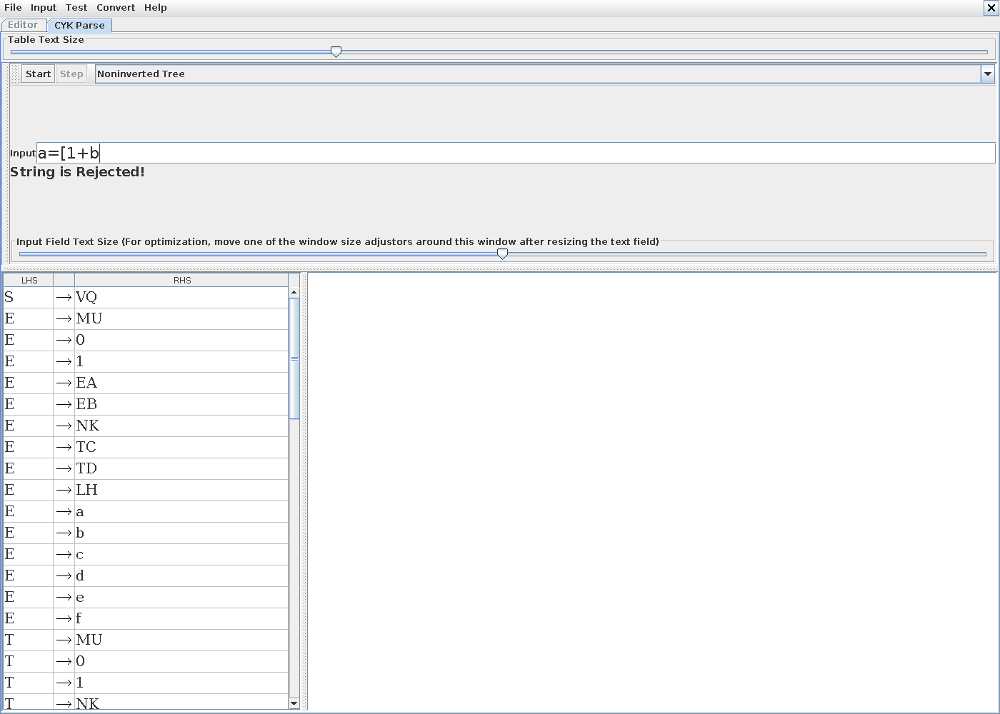

# Практическая работа № 4 — вариант 1

**Дисциплина:** Теория автоматов, языков и вычислений  
**Студент:** Шапельский Марк Владиславович, КИ24-16/2Б, 1 подгруппа  
**Университет:** СФУ, ИКИТ  
**Преподаватель:** Фарафонов М. М.  
**Тема:** Синтаксический анализ контекстно-свободных языков.

[Отчёт PDF](report.pdf) · [Отчёт DOCX](report.docx) · [Грамматика JFLAP](L01_CYK.jff) · [CYK на Python](cyk.py) · [Алгоритм Эрли](earley.py)

## 1. Цель и постановка задачи

Цель работы: исследование свойств универсальных алгоритмов синтаксического анализа контекстно-свободных языков.

По варианту 1 из Pr_04.pdf требуется построить грамматику языка оператора присваивания. Справа находится арифметическое выражение из целочисленных двоичных констант, переменных a–f, знаков операций и скобок. Грамматику необходимо подготовить для анализа методом Кока–Янгера–Касами в JFLAP.

### 1.1. Принятые обозначения

| Элемент | Запись и ограничения |
|---|---|
| Присваивание | `=`; слева ровно одна переменная, справа непустое выражение |
| Переменные | `a`, `b`, `c`, `d`, `e`, `f` |
| Константы | Непустые строки из `0` и `1`; ведущие нули разрешены |
| Унарная операция | `-`; максимальный приоритет |
| Мультипликативные | `*`, `/`; следующий приоритет, левая ассоциативность |
| Аддитивные | `+`, `-`; следующий приоритет, левая ассоциативность |
| Скобки | `[` и `]`; могут вкладываться |

Выбран стандартный минимальный набор арифметических знаков. Он реализует все классы операций, перечисленные в варианте 1. Унарный плюс, возведение в степень и остаток от деления в язык не включены. Присваивание имеет самый низкий приоритет и встречается ровно один раз, в начале оператора после переменной.

Ведущие нули не запрещены условием, поэтому `0001` является корректной записью числа. Знак отрицательного числа разбирается как унарная операция. Повторный минус допустим: `--1` означает `-[-1]`. Пробелы, переводы строк, точки с запятой и цифры 2–9 не входят во входной алфавит. Никакая предварительная очистка или токенизация не выполняется. Для группировки выбраны квадратные скобки [ и ]: методичка не задаёт их вид, а штатная команда CYK Parse в JFLAP 7.1 резервирует круглые скобки для внутренних обозначений преобразования грамматик и отклоняет их даже в готовой НФХ. Круглые скобки во входной строке этой реализации не допускаются. Например, вводится `b=[a+1]*10`, непосредственно этими символами.

Анализатор проверяет синтаксис, а не значения выражений. Например, `a=1/0` синтаксически корректно, хотя вычисление содержит деление на ноль. Объявления переменных и их значения не проверяются.

## 2. Теоретические сведения

Контекстно-свободная грамматика имеет вид G = (V, Σ, P, S), где V — нетерминалы, Σ — терминалы, P — правила, S — стартовый символ. Слева каждого правила находится один нетерминал.

В нормальной форме Хомского допустимы правила A → BC и A → t, где A, B, C — нетерминалы, t — один терминал. Здесь пустое слово языку не принадлежит, поэтому исключение S → ε не требуется. Цепных правил A → B нет. Стартовый символ S не встречается справа.

Для слова w длины n алгоритм CYK строит таблицу C[i, ℓ]: множество нетерминалов, выводящих подстроку длины ℓ с позиции i (в объяснениях позиции начинаются с 1).

1. При ℓ = 1 в C[i, 1] записываются все A, для которых есть A → wᵢ.
2. Для длин ℓ = 2, …, n рассматриваются все разбиения k = 1, …, ℓ−1.
3. Если A → BC, B ∈ C[i, k] и C ∈ C[i+k, ℓ−k], то A добавляется в C[i, ℓ].
4. Строка принимается тогда и только тогда, когда S ∈ C[1, n].

Корректность следует по индукции по длине подстроки: односимвольный случай задают терминальные правила, а любое дерево вывода более длинной строки в НФХ разделяется на два поддерева по некоторой границе k. CYK перебирает все такие границы. Для фиксированной грамматики время O(n³), память O(n²). Если учитывать размер грамматики, множества в ячейках содержат до |V| элементов, а реализация с перебором пар имеет верхнюю оценку O(n³|V|² + |P|).

## 3. Исходная грамматика с приоритетами

```text
S → V=E
E → E+T | E-T | T
T → T*U | T/U | U
U → -U | [E] | V | N
V → a | b | c | d | e | f
N → NK | 0 | 1
K → 0 | 1
```

| Нетерминал | Назначение |
|---|---|
| S | Полный оператор присваивания |
| E | Выражение, верхний уровень сложения и вычитания |
| T | Произведение или частное |
| U | Унарный минус, скобочное выражение или операнд |
| V | Односимвольная переменная |
| N | Непустое двоичное число |
| K | Одна двоичная цифра |

Уровни E, T, U фиксируют приоритет: в правиле E → E+T справа от плюса находится целый терм T, который может включать умножение. Поэтому `a+b*10` разбирается как `a+[b*10]`. Леворекурсивные правила E → E−T и T → T/U задают левую ассоциативность. Правило U → −U задаёт вложение унарных минусов справа. Скобки U → [E] снова допускают выражение любого уровня.

Правила N → NK | 0 | 1 выводят ровно непустые двоичные строки. База даёт одну цифру, каждый рекурсивный шаг дописывает ещё одну. Другие символы получить нельзя. Обратно, любую непустую двоичную строку можно построить, выделяя последнюю цифру до односимвольной базы.

## 4. Преобразование к НФХ

### 4.1. Проверка пустых правил

В исходной грамматике нет ε-правил. Ни один нетерминал не выводит пустое слово, поэтому на этом этапе правила не меняются. S не встречается в правых частях, новый стартовый символ не нужен.

### 4.2. Удаление цепных правил

Цепные правила: E → T, T → U, U → V, U → N. Для каждого нетерминала берём все достижимые по цепным правилам нетерминалы и переносим их нецепные правила.

| Нетерминал | Цепное замыкание, включая сам символ |
|---|---|
| E | E, T, U, V, N |
| T | T, U, V, N |
| U | U, V, N |
| S, V, N, K | Только сам соответствующий символ |

Например, E получает E+T, E−T, T*U, T/U, −U, [E], a–f, NK, 0 и 1. T получает те же альтернативы, кроме E+T и E−T. U получает −U, [E], a–f, NK, 0 и 1. После копирования все четыре цепных правила удаляются. Язык сохраняется: последовательность цепных шагов заменяется одним перенесённым правилом, и наоборот.

### 4.3. Замена терминалов в составных правилах

Вводим Z → =, P → +, M → −, R → *, W → /, L → [, J → ]. В файле используется обычный ASCII-дефис `-`, а не типографский минус. Например, V=E становится VZE, E+T становится EPT, −U становится MU, [E] становится LEJ. Односимвольные терминальные правила не меняются.

### 4.4. Бинаризация

| Составная правая часть | Замена | Дополнительное правило |
|---|---|---|
| VZE | VQ | Q → ZE |
| EPT | EA | A → PT |
| EMT | EB | B → MT |
| TRU | TC | C → RU |
| TWU | TD | D → WU |
| LEJ | LH | H → EJ |

Для повторяющихся пар используются одни и те же вспомогательные символы. Каждая замена лишь вставляет дополнительный узел дерева, поэтому порядок терминалов и язык сохраняются. Нет бесполезных нетерминалов: все достижимы из S и могут вывести терминальные строки.

## 5. Итоговая грамматика

```text
S → VQ
E → MU | 0 | 1 | EA | EB | NK | TC | TD | LH | a | b | c | d | e | f
T → MU | 0 | 1 | NK | TC | TD | LH | a | b | c | d | e | f
U → MU | 0 | 1 | NK | LH | a | b | c | d | e | f
V → a | b | c | d | e | f
N → 0 | 1 | NK
K → 0 | 1
Z → =
P → +
M → -
R → *
W → /
L → [
J → ]
Q → ZE
A → PT
B → MT
C → RU
D → WU
H → EJ
```

Знак `|` разделяет альтернативы только в описании. В JFLAP каждая альтернатива записана отдельной продукцией.

Всего **64 правила и 20 нетерминалов**. Терминальный алфавит: Σ = {a, b, c, d, e, f, 0, 1, =, +, -, *, /, [, ]}. Нетерминалы: V = {S, E, T, U, V, N, K, Z, P, M, R, W, L, J, Q, A, B, C, D, H}. Здесь V в составе кортежа обозначает множество, а символ V внутри правил обозначает переменную языка.

Новые нетерминалы Q, A, B, C, D и H хранят правые части присваивания, аддитивной операции, мультипликативной операции и скобочной конструкции соответственно. Z, P, M, R, W, L, J представляют отдельные знаки.

Каждая правая часть состоит либо из двух заглавных нетерминалов, либо из одного терминала. Пустых и цепных правил нет; S справа отсутствует. Следовательно, грамматика действительно находится в НФХ. Проверка формата правил выполняется также программно в load_grammar().

## 6. Реализация в JFLAP 7.1

Файл [L01_CYK.jff](L01_CYK.jff) содержит XML-модель типа grammar. Первым идёт правило S → VQ, поэтому стартовый символ — S. Все нетерминалы односимвольные; терминалы считываются непосредственно из входной строки.

Модель открыта штатным обработчиком Open JFLAP 7.1. Для 16 основных примеров выполнены CYK Parse, Start и последовательные Step до окончания доступного вывода. На снимках видны вкладка CYK Parse, входная строка и фактический результат. Для принятых строк показано дерево либо таблица вывода, восстановленные CYK; для отвергнутых дерево отсутствует. Треугольную таблицу CYK этот экран JFLAP не показывает; её можно вывести реализацией Python через --table.

Дополнительно все 32 строки проверены классом grammar.parse.CYKParser из того же JFLAP7.1.jar после чтения модели штатным XMLCodec. Результаты сохранены в [test_results.csv](test_results.csv).

## 7. Тестирование

В основной серии 10 корректных и 6 некорректных строк. В колонках таблицы отражены реальные результаты трёх реализаций. ACCEPT означает принятие, REJECT — отвержение.

| № | Вход | Ожидается | JFLAP CYK | Python CYK | Эрли |
|---|---|---|---|---|---|
| 1 | `a=101` | ACCEPT | ACCEPT | ACCEPT | ACCEPT |
| 2 | `b=f` | ACCEPT | ACCEPT | ACCEPT | ACCEPT |
| 3 | `c=a+1` | ACCEPT | ACCEPT | ACCEPT | ACCEPT |
| 4 | `d=10-b` | ACCEPT | ACCEPT | ACCEPT | ACCEPT |
| 5 | `e=a*11` | ACCEPT | ACCEPT | ACCEPT | ACCEPT |
| 6 | `f=10/b` | ACCEPT | ACCEPT | ACCEPT | ACCEPT |
| 7 | `a=-1` | ACCEPT | ACCEPT | ACCEPT | ACCEPT |
| 8 | `b=[a+1]*10` | ACCEPT | ACCEPT | ACCEPT | ACCEPT |
| 9 | `c=-[[a+1]*b]` | ACCEPT | ACCEPT | ACCEPT | ACCEPT |
| 10 | `d=a+b*10-1` | ACCEPT | ACCEPT | ACCEPT | ACCEPT |
| 11 | `a=102` | REJECT | REJECT | REJECT | REJECT |
| 12 | `g=1` | REJECT | REJECT | REJECT | REJECT |
| 13 | `a=1+` | REJECT | REJECT | REJECT | REJECT |
| 14 | `a=[1+b` | REJECT | REJECT | REJECT | REJECT |
| 15 | `a=[]` | REJECT | REJECT | REJECT | REJECT |
| 16 | `a=b=1` | REJECT | REJECT | REJECT | REJECT |
| 17 | `a=0001` | ACCEPT | ACCEPT | ACCEPT | ACCEPT |
| 18 | `a=--1` | ACCEPT | ACCEPT | ACCEPT | ACCEPT |
| 19 | `a=1--b` | ACCEPT | ACCEPT | ACCEPT | ACCEPT |
| 20 | `a=1/0` | ACCEPT | ACCEPT | ACCEPT | ACCEPT |
| 21 | `a=+1` | REJECT | REJECT | REJECT | REJECT |
| 22 | `a=1**b` | REJECT | REJECT | REJECT | REJECT |
| 23 | `a=1 0` | REJECT | REJECT | REJECT | REJECT |
| 24 | `ε` | REJECT | REJECT | REJECT | REJECT |
| 25 | `a=` | REJECT | REJECT | REJECT | REJECT |
| 26 | `ab=1` | REJECT | REJECT | REJECT | REJECT |
| 27 | `a=1b` | REJECT | REJECT | REJECT | REJECT |
| 28 | `a=0` | ACCEPT | ACCEPT | ACCEPT | ACCEPT |
| 29 | `a=1/10/11` | ACCEPT | ACCEPT | ACCEPT | ACCEPT |
| 30 | `a=1-10-11` | ACCEPT | ACCEPT | ACCEPT | ACCEPT |
| 31 | `a=1]` | REJECT | REJECT | REJECT | REJECT |
| 32 | `a=01.1` | REJECT | REJECT | REJECT | REJECT |

### 7.1. `a=101` — ACCEPT

Простое присваивание двоичного числа. Ожидаемый результат: **ACCEPT**. Фактический результат JFLAP: **ACCEPT**.

1. В нижний слой таблицы записываются нетерминалы для каждого символа строки.
2. По бинарным правилам объединяются соседние подстроки; ниже приведён один полный вывод, восстановленный по заполненной таблице.
3. В итоговой ячейке C[1, 5] находится S, следовательно, строка принята.

```text
S
⇒ VQ
⇒ aQ
⇒ aZE
⇒ a=E
⇒ a=NK
⇒ a=NKK
⇒ a=1KK
⇒ a=10K
⇒ a=101
```



### 7.2. `b=f` — ACCEPT

Присваивание переменной f. Ожидаемый результат: **ACCEPT**. Фактический результат JFLAP: **ACCEPT**.

1. В нижний слой таблицы записываются нетерминалы для каждого символа строки.
2. По бинарным правилам объединяются соседние подстроки; ниже приведён один полный вывод, восстановленный по заполненной таблице.
3. В итоговой ячейке C[1, 3] находится S, следовательно, строка принята.

```text
S
⇒ VQ
⇒ bQ
⇒ bZE
⇒ b=E
⇒ b=f
```



### 7.3. `c=a+1` — ACCEPT

Сложение. Ожидаемый результат: **ACCEPT**. Фактический результат JFLAP: **ACCEPT**.

1. В нижний слой таблицы записываются нетерминалы для каждого символа строки.
2. По бинарным правилам объединяются соседние подстроки; ниже приведён один полный вывод, восстановленный по заполненной таблице.
3. В итоговой ячейке C[1, 5] находится S, следовательно, строка принята.

```text
S
⇒ VQ
⇒ cQ
⇒ cZE
⇒ c=E
⇒ c=EA
⇒ c=aA
⇒ c=aPT
⇒ c=a+T
⇒ c=a+1
```



### 7.4. `d=10-b` — ACCEPT

Вычитание. Ожидаемый результат: **ACCEPT**. Фактический результат JFLAP: **ACCEPT**.

1. В нижний слой таблицы записываются нетерминалы для каждого символа строки.
2. По бинарным правилам объединяются соседние подстроки; ниже приведён один полный вывод, восстановленный по заполненной таблице.
3. В итоговой ячейке C[1, 6] находится S, следовательно, строка принята.

```text
S
⇒ VQ
⇒ dQ
⇒ dZE
⇒ d=E
⇒ d=EB
⇒ d=NKB
⇒ d=1KB
⇒ d=10B
⇒ d=10MT
⇒ d=10-T
⇒ d=10-b
```



### 7.5. `e=a*11` — ACCEPT

Умножение. Ожидаемый результат: **ACCEPT**. Фактический результат JFLAP: **ACCEPT**.

1. В нижний слой таблицы записываются нетерминалы для каждого символа строки.
2. По бинарным правилам объединяются соседние подстроки; ниже приведён один полный вывод, восстановленный по заполненной таблице.
3. В итоговой ячейке C[1, 6] находится S, следовательно, строка принята.

```text
S
⇒ VQ
⇒ eQ
⇒ eZE
⇒ e=E
⇒ e=TC
⇒ e=aC
⇒ e=aRU
⇒ e=a*U
⇒ e=a*NK
⇒ e=a*1K
⇒ e=a*11
```



### 7.6. `f=10/b` — ACCEPT

Деление. Ожидаемый результат: **ACCEPT**. Фактический результат JFLAP: **ACCEPT**.

1. В нижний слой таблицы записываются нетерминалы для каждого символа строки.
2. По бинарным правилам объединяются соседние подстроки; ниже приведён один полный вывод, восстановленный по заполненной таблице.
3. В итоговой ячейке C[1, 6] находится S, следовательно, строка принята.

```text
S
⇒ VQ
⇒ fQ
⇒ fZE
⇒ f=E
⇒ f=TD
⇒ f=NKD
⇒ f=1KD
⇒ f=10D
⇒ f=10WU
⇒ f=10/U
⇒ f=10/b
```


### 7.7. `a=-1` — ACCEPT

Унарный минус. Ожидаемый результат: **ACCEPT**. Фактический результат JFLAP: **ACCEPT**.

1. В нижний слой таблицы записываются нетерминалы для каждого символа строки.
2. По бинарным правилам объединяются соседние подстроки; ниже приведён один полный вывод, восстановленный по заполненной таблице.
3. В итоговой ячейке C[1, 4] находится S, следовательно, строка принята.

```text
S
⇒ VQ
⇒ aQ
⇒ aZE
⇒ a=E
⇒ a=MU
⇒ a=-U
⇒ a=-1
```



### 7.8. `b=[a+1]*10` — ACCEPT

Скобки меняют порядок операций. Ожидаемый результат: **ACCEPT**. Фактический результат JFLAP: **ACCEPT**.

1. В нижний слой таблицы записываются нетерминалы для каждого символа строки.
2. По бинарным правилам объединяются соседние подстроки; ниже приведён один полный вывод, восстановленный по заполненной таблице.
3. В итоговой ячейке C[1, 10] находится S, следовательно, строка принята.

```text
S
⇒ VQ
⇒ bQ
⇒ bZE
⇒ b=E
⇒ b=TC
⇒ b=LHC
⇒ b=[HC
⇒ b=[EJC
⇒ b=[EAJC
⇒ b=[aAJC
⇒ b=[aPTJC
⇒ b=[a+TJC
⇒ b=[a+1JC
⇒ b=[a+1]C
⇒ b=[a+1]RU
⇒ b=[a+1]*U
⇒ b=[a+1]*NK
⇒ b=[a+1]*1K
⇒ b=[a+1]*10
```

![JFLAP 7.1, CYK: b=\[a+1\]*10, ACCEPT](screenshots/test_08_grouping.png)

### 7.9. `c=-[[a+1]*b]` — ACCEPT

Вложенные скобки и унарный минус. Ожидаемый результат: **ACCEPT**. Фактический результат JFLAP: **ACCEPT**.

1. В нижний слой таблицы записываются нетерминалы для каждого символа строки.
2. По бинарным правилам объединяются соседние подстроки; ниже приведён один полный вывод, восстановленный по заполненной таблице.
3. В итоговой ячейке C[1, 12] находится S, следовательно, строка принята.

```text
S
⇒ VQ
⇒ cQ
⇒ cZE
⇒ c=E
⇒ c=MU
⇒ c=-U
⇒ c=-LH
⇒ c=-[H
⇒ c=-[EJ
⇒ c=-[TCJ
⇒ c=-[LHCJ
⇒ c=-[[HCJ
⇒ c=-[[EJCJ
⇒ c=-[[EAJCJ
⇒ c=-[[aAJCJ
⇒ c=-[[aPTJCJ
⇒ c=-[[a+TJCJ
⇒ c=-[[a+1JCJ
⇒ c=-[[a+1]CJ
⇒ c=-[[a+1]RUJ
⇒ c=-[[a+1]*UJ
⇒ c=-[[a+1]*bJ
⇒ c=-[[a+1]*b]
```

![JFLAP 7.1, CYK: c=-\[\[a+1\]*b\], ACCEPT](screenshots/test_09_nested_expression.png)

### 7.10. `d=a+b*10-1` — ACCEPT

Несколько операций разного приоритета. Ожидаемый результат: **ACCEPT**. Фактический результат JFLAP: **ACCEPT**.

1. В нижний слой таблицы записываются нетерминалы для каждого символа строки.
2. По бинарным правилам объединяются соседние подстроки; ниже приведён один полный вывод, восстановленный по заполненной таблице.
3. В итоговой ячейке C[1, 10] находится S, следовательно, строка принята.

```text
S
⇒ VQ
⇒ dQ
⇒ dZE
⇒ d=E
⇒ d=EB
⇒ d=EAB
⇒ d=aAB
⇒ d=aPTB
⇒ d=a+TB
⇒ d=a+TCB
⇒ d=a+bCB
⇒ d=a+bRUB
⇒ d=a+b*UB
⇒ d=a+b*NKB
⇒ d=a+b*1KB
⇒ d=a+b*10B
⇒ d=a+b*10MT
⇒ d=a+b*10-T
⇒ d=a+b*10-1
```



### 7.11. `a=102` — REJECT

Цифра 2 не принадлежит двоичному алфавиту. Ожидаемый результат: **REJECT**. Фактический результат JFLAP: **REJECT**.

1. Префикс a= корректен: V выводит a, Z выводит =.
2. Для символа 2 нет терминального правила, соответствующая ячейка C[5, 1] пуста.
3. Никакое дерево не может покрыть этот символ, поэтому S отсутствует в итоговой ячейке.



### 7.12. `g=1` — REJECT

Переменная g не входит в a–f. Ожидаемый результат: **REJECT**. Фактический результат JFLAP: **REJECT**.

1. В позиции 1 находится g, для которого нет терминального правила.
2. Левая часть присваивания V может вывести только a–f.
3. Начальную ячейку нельзя включить в S → VQ; итоговая ячейка пуста.



### 7.13. `a=1+` — REJECT

После плюса отсутствует операнд. Ожидаемый результат: **REJECT**. Фактический результат JFLAP: **REJECT**.

1. Подстрока 1 выводится из E, T, U, N и K.
2. Последний + выводится только из P; правило A → PT требует справа непустой T.
3. После + нет символов, поэтому E не покрывает правую часть 1+, а S не покрывает строку.


### 7.14. `a=[1+b` — REJECT

Нет закрывающей скобки. Ожидаемый результат: **REJECT**. Фактический результат JFLAP: **REJECT**.

1. Встречается открывающая скобка L → [.
2. Правила U → LH и H → EJ требуют закрывающий символ J → ].
3. Символа ] в строке нет; получить полное E и затем S невозможно.



### 7.15. `a=[]` — REJECT

Пустые скобки не являются выражением. Ожидаемый результат: **REJECT**. Фактический результат JFLAP: **REJECT**.

1. Скобки распознаются как L и J.
2. Между ними должен находиться E: U → LH, H → EJ.
3. E не выводит пустое слово, поэтому [] не является выражением, S отсутствует.

![JFLAP 7.1, CYK: a=\[\], REJECT](screenshots/test_15_empty_brackets.png)

### 7.16. `a=b=1` — REJECT

Повторное присваивание запрещено. Ожидаемый результат: **REJECT**. Фактический результат JFLAP: **REJECT**.

1. Начальное a= соответствует левой части присваивания.
2. Оставшаяся подстрока b=1 содержит второй =.
3. Из E нет пути к Z или Q; знак = может возникнуть только в присваивании верхнего уровня. Итоговая ячейка не содержит S.


### 7.17. Дополнительные проверки

Тесты 17–32 проверяют ведущие нули, повторный минус, различие синтаксиса и семантики, отсутствие неявного умножения, пустой ввод, дробные числа и лишние скобки. Они выполнены автоматическим CYK JFLAP и обеими программами Python; отдельных снимков для этой дополнительной серии нет.

## 8. Реализации CYK и Эрли

[cyk.py](cyk.py) читает непосредственно L01_CYK.jff, проверяет НФХ и выполняет распознавание на уровне символов. Индексирование в коде начинается с 0; при печати таблицы позиции начинаются с 1. Для пустого ввода возвращается REJECT. Неизвестные символы дают пустые множества в односимвольных ячейках и не могут быть приняты.

[earley.py](earley.py) работает с исходной грамматикой из [grammar.py](grammar.py). Состояние имеет вид (A → α•β, j): точка отмечает уже прочитанную часть правила, j — начало разбираемой конструкции. На каждом шаге выполняются предсказание правил нетерминала, сканирование очередного терминала и завершение продукции. Множества состояний исключают повторную обработку одинаковых элементов и позволяют работать с левой рекурсией. Завершённое стартовое состояние в последнем наборе означает принятие. Реализация предназначена для данной грамматики без ε-правил.

### 8.1. Запуск

Нужен Python 3.10 или новее; внешние библиотеки не требуются. Команды выполняются из папки pr04:

```bash
python cyk.py "a=101"
python cyk.py "b=[a+1]*10" --table
python cyk.py "a=102"
python earley.py "d=a+b*10-1" --table
python test_parsers.py
```

Первый пример выводит ACCEPT, третий — REJECT. Обе программы возвращают код завершения 0 при принятии и 1 при отвержении. Параметр --table печатает всю таблицу CYK или наборы состояний Эрли. Команда `python grammar.py` воспроизводимо создаёт ту же модель L01_CYK.jff; при обычном запуске анализаторов она не требуется.

### 8.2. Проверка программ

В [test_parsers.py](test_parsers.py) проверены:

- соответствие XML-модели результату преобразования и ограничениям НФХ;
- все 32 основных и дополнительных примера;
- все 7 381 правых частей длиной от 0 до 4 над алфавитом `a01+-*/[]` с префиксом `a=`;
- 400 сгенерированных корректных выражений и по три модификации каждого, всего 1 600 проверок.

В последних двух группах результаты CYK и Эрли сопоставлены с независимым анализатором рекурсивного спуска. Он не использует таблицу продукций, что позволяет обнаружить общую ошибку двух грамматических реализаций. Все четыре группы тестов прошли. Это проверка на конечном наборе, а не замена доказательства эквивалентности грамматик.

## 9. Анализ результатов

Все 32 ожидаемых ответа совпали с CYK JFLAP, CYK Python и Эрли. Первые 16 подтверждены снимками интерфейса. Корректные числа, переменные, унарные операции и вложенные скобки принимаются. Нарушения алфавита, пропущенные операнды и повторное присваивание отвергаются.

Результат ACCEPT сам по себе не доказывает правильность приоритета: одна и та же строка может принадлежать языкам с разными деревьями. Приоритеты и ассоциативность проверяются структурой исходных правил и дерева. Для `d=a+b*10-1` верхний уровень — вычитание, левое подвыражение — сумма a и произведения b*10. Для `a=1-10-11` и `a=1/10/11` леворекурсивные правила задают `[1-10]-11` и `[1/10]/11`. Преобразование в НФХ сохраняет эту структуру с дополнительными вспомогательными узлами.

Практически CYK удобно использовать после нормализации: его таблица явно показывает, какие подстроки выводятся. Эрли работает с исходными правилами и не требует преобразования в НФХ. В обоих случаях анализ является синтаксическим.

## 10. Вывод

Для варианта 1 построена контекстно-свободная грамматика оператора присваивания с двоичными константами и переменными a–f. В грамматике учтены приоритеты, левая ассоциативность бинарных операций и вложенные скобки. Выполнено преобразование в НФХ без пустых и цепных правил. Модель проверена алгоритмом CYK в JFLAP 7.1. Дополнительно реализованы CYK и Эрли на Python; результаты трёх реализаций совпали на общем наборе тестов.

## 11. Состав файлов

| Файл | Назначение |
|---|---|
| [L01_CYK.jff](L01_CYK.jff) | Итоговая грамматика НФХ, 64 правила |
| [report.pdf](report.pdf) | Отчёт с титульным листом и 16 снимками JFLAP |
| [report.docx](report.docx) | Редактируемая версия отчёта |
| [screenshots/](screenshots/) | 16 реальных снимков CYK Parse |
| [cyk.py](cyk.py) | CYK, чтение JFF, вывод таблицы |
| [earley.py](earley.py) | Эрли для исходной грамматики |
| [grammar.py](grammar.py) | Исходные правила и преобразование в НФХ |
| [tests.json](tests.json) | 32 тестовые строки с ожидаемыми ответами |
| [test_parsers.py](test_parsers.py) | Автоматические проверки и независимый анализатор |
| [test_results.csv](test_results.csv) | Ожидаемые и фактические ответы JFLAP и Python |
| README.md | Постановка, грамматики, выводы и встроенные снимки |

Для демонстрации откройте L01_CYK.jff в JFLAP 7.1, выберите Input → CYK Parse, введите строку и нажмите Start. Step показывает восстановление дерева вывода для принятой строки.
